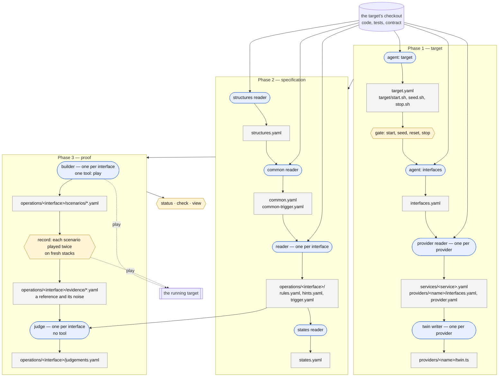
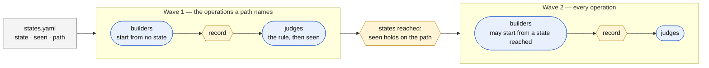

# The flow of an extraction

`exspec extract <dir>` runs three phases in order, each named for the group of concepts it
writes: the target, the specification, the proof. A phase is steps in order — a session of
the agent, or a role on its subjects — and each step is skipped when the files under
`<dir>/exspec/` already pass its check, so a run stopped anywhere picks up what is left. This
page shows who runs in each step and which file each one writes; the commands
are in [`commands.md`](commands.md), the reasons in [`adr/`](adr/README.md).

## The whole picture

Rounded boxes are **agents** (a session of the model), hexagons are **steps of the tool**
(no model), plain boxes are **files** under `exspec/`.



Three roles are kept apart on purpose: a **reader** sees the code and never runs the
system; a **builder** calls the system and never sees its code; a **judge** sees only the
recordings and the rule. A verdict is therefore never the opinion of the one who wrote
the rule.

## Who reads what, who writes what

| Phase | Step | Reads | Writes | Its check |
|---|---|---|---|---|
| target | the target's session | the checkout | `target.yaml`, `target/` | each provider declared is named at the proxy where the target is started; the target starts, is seeded, is reset, stops |
| target | the interfaces' session | the contract, else the code | `interfaces.yaml` | the file passes its check |
| target | provider reader, one per provider declared | the checkout, `target.yaml`, `target/`, `services/` | `services/<service>.yaml`, `providers/<name>/interfaces.yaml`, `provider.yaml` | the provider's files and its service pass their check |
| target | twin writer, one per provider read | its provider's files and service only | `providers/<name>/twin.ts` | the twin is served, its state put back, each condition taken |
| specification | structures reader | the code | `structures.yaml` | the structures' file |
| specification | common reader | the code | `common.yaml`, `common-trigger.yaml` | both files |
| specification | reader, one per interface | the code, the structures, the common files, `services/` | `operations/<interface>/rules.yaml`, `hints.yaml`, `trigger.yaml` | the three files pass their check |
| specification | states reader, once | `exspec/` only: structures, interfaces, every rule and hint | `states.yaml` | each state serves rules of two operations at least |
| proof | builder, one per interface | its rules and hints, `states.yaml`, the paths of the states; **the system through `play` only** | `scenarios/<slug>.yaml` | every scenario is well formed and plays |
| proof | the tool (`record`) | the scenarios | `evidence/<slug>.yaml` | two plays agree outside the noise |
| proof | judge, one per interface | the rule and the recording, nothing else | `judgements.yaml` | a verdict per reference |

A session's step is skipped when its file passes its check: it runs again when its file is
removed, not when its phase is named.

The target's session declares the providers the target calls — `proxy` and `observables`
in `target.yaml` — and points the target at the proxy, `http://127.0.0.1:<port>/<name>`;
a target that calls none declares neither, and its phase has its two sessions only. The
providers' two roles are skipped as their files pass. Nothing stands in front of the
providers before the proof: the proxy and the twins are stood when the proof starts, from
`target.yaml` as it is then, and stopped when `extract` ends or is interrupted.

A check that fails sends its findings back to the same session, three times at most.

## The proof and the states

A state (`states.yaml`) is a business situation several operations need — a session
planned, a learner enrolled. It names the scenario that reaches it, its **path**. Other
scenarios start from the state instead of rebuilding it: the tool plays the path's steps
in its place.

A state can be started from only once it is **reached**: its path recorded, and its
sentence (`seen`) judged to hold on that recording. So the proof runs in two waves.



```yaml
# a scenario that starts from a state
steps:
  - {when: arrange, state: s, name: p}     # replaced by the steps of the path of s
  - {when: call, as: a, call: {operation: f, with: {x: "{{p.c.id}}"}}}
```

A state not reached yet is a gap of `check`; a state its path does not show is a problem.

## The files of an extraction

```
exspec/
  target.yaml              how the target starts, is seeded, is reset          target
  target/                  the scripts it runs, the credentials the seed wrote
  interfaces.yaml          every interface, what it accepts and answers        target
  structures.yaml          the business concepts, named once for all readers   specification
  states.yaml              the named states, each with its path
  services/<service>.yaml  what the system needs of someone else               target
  providers/<name>/        the provider this target calls, its twin            target
  common.yaml              what holds for every operation
  common-trigger.yaml      how each shared refusal leaves, the error bodies
  operations/<interface>/
    rules.yaml             what the operation requires, does and answers       specification
    hints.yaml             for each rule, a situation and how to reach it
    trigger.yaml           how the interface is bound to the operation
    scenarios/<slug>.yaml  one scenario per rule and situation                 proof
    evidence/<slug>.yaml   what the target answered, and its noise
    judgements.yaml        a verdict per scenario, and per state               proof
```

Nothing derived is stored: `status`, `check` and `view` compute what is verified, refuted
or only declared from these files every time.

## Beside the extraction

- **Providers** (`providers read`, `providers write-twin`): the target's phase's two
  roles, run for one provider (`--only`) or alone.
- **Replay** (`roles replay`): each reference played once more and compared outside its
  noise — what tells that the target changed.
