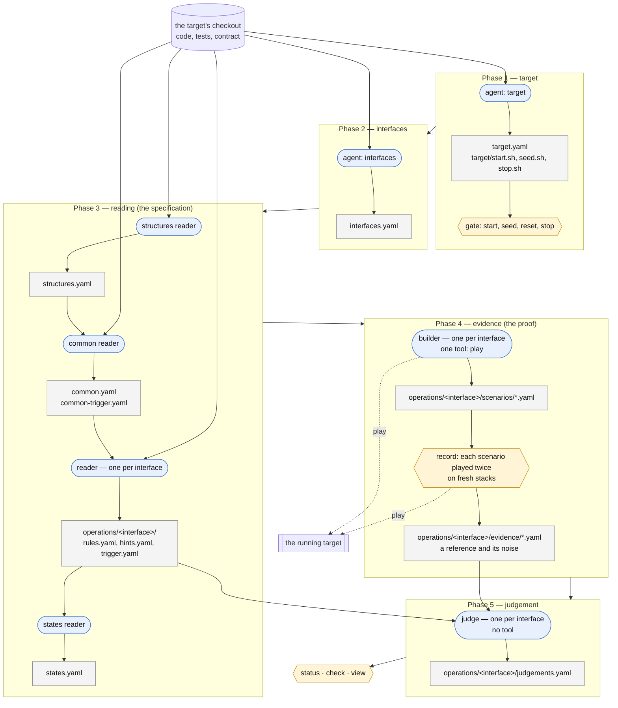
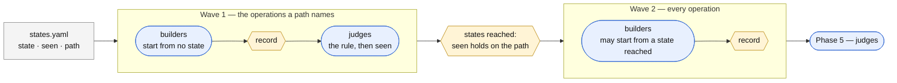

# The flow of an extraction

`exspec extract <dir>` runs five phases in order. Each phase is skipped when the files
under `<dir>/exspec/` already pass its check, so a run stopped anywhere picks up what is
left. This page shows who runs in each phase and which file each one writes; the commands
are in [`commands.md`](commands.md), the reasons in [`adr/`](adr/README.md).

## The whole picture

Rounded boxes are **agents** (a session of the model), hexagons are **steps of the tool**
(no model), plain boxes are **files** under `exspec/`.



Three roles are kept apart on purpose: a **reader** sees the code and never runs the
system; a **builder** calls the system and never sees its code; a **judge** sees only the
recordings and the rule. A verdict is therefore never the opinion of the one who wrote
the rule.

## Who reads what, who writes what

| Phase | Who | Reads | Writes | Its check |
|---|---|---|---|---|
| target | agent, one session | the checkout | `target.yaml`, `target/` | the target starts, is seeded, is reset, stops |
| interfaces | agent, one session | the contract, else the code | `interfaces.yaml` | the file passes its check |
| reading | structures reader | the code | `structures.yaml` | the structures' file |
| reading | common reader | the code | `common.yaml`, `common-trigger.yaml` | both files |
| reading | reader, one per interface | the code, the structures, the common files, `services/` | `operations/<interface>/rules.yaml`, `hints.yaml`, `trigger.yaml` | the three files pass their check |
| reading | states reader, once | `exspec/` only: structures, interfaces, every rule and hint | `states.yaml` | each state serves rules of two operations at least |
| evidence | builder, one per interface | its rules and hints, `states.yaml`, the paths of the states; **the system through `play` only** | `scenarios/<slug>.yaml` | every scenario is well formed and plays |
| evidence | the tool (`record`) | the scenarios | `evidence/<slug>.yaml` | two plays agree outside the noise |
| judgement | judge, one per interface | the rule and the recording, nothing else | `judgements.yaml` | a verdict per reference |

A check that fails sends its findings back to the same session, three times at most.

## The evidence phase and the states

A state (`states.yaml`) is a business situation several operations need — a session
planned, a learner enrolled. It names the scenario that reaches it, its **path**. Other
scenarios start from the state instead of rebuilding it: the tool plays the path's steps
in its place.

A state can be started from only once it is **reached**: its path recorded, and its
sentence (`seen`) judged to hold on that recording. So the evidence phase runs in two
waves.



```yaml
# a scenario that starts from a state
steps:
  - {when: arrange, state: s, name: p}     # replaced by the steps of the path of s
  - {when: call, as: a, call: {operation: f, with: {x: "{{p.c.id}}"}}}
```

A state not reached yet is a gap of `check`; a state its path does not show is a problem.

## The files of an extraction

```
exspec/
  target.yaml              how the target starts, is seeded, is reset          phase 1
  target/                  the scripts it runs, the credentials the seed wrote
  interfaces.yaml          every interface, what it accepts and answers        phase 2
  structures.yaml          the business concepts, named once for all readers   phase 3
  states.yaml              the named states, each with its path
  services/<service>.yaml  what the system needs of someone else               providers read
  providers/<name>/        the provider this target calls, its twin            providers write-twin
  common.yaml              what holds for every operation
  common-trigger.yaml      how each shared refusal leaves, the error bodies
  operations/<interface>/
    rules.yaml             what the operation requires, does and answers       phase 3
    hints.yaml             for each rule, a situation and how to reach it
    trigger.yaml           how the interface is bound to the operation
    scenarios/<slug>.yaml  one scenario per rule and situation                 phase 4
    evidence/<slug>.yaml   what the target answered, and its noise
    judgements.yaml        a verdict per scenario, and per state               phase 5
```

Nothing derived is stored: `status`, `check` and `view` compute what is verified, refuted
or only declared from these files every time.

## Beside the extraction

- **Providers**, before `extract`, on a target that calls other systems: a provider
  reader writes `services/` and `providers/<name>/`, a twin writer writes the twin that
  stands for the provider while scenarios are played.
- **Replay** (`roles replay`): each reference played once more and compared outside its
  noise — what tells that the target changed.
