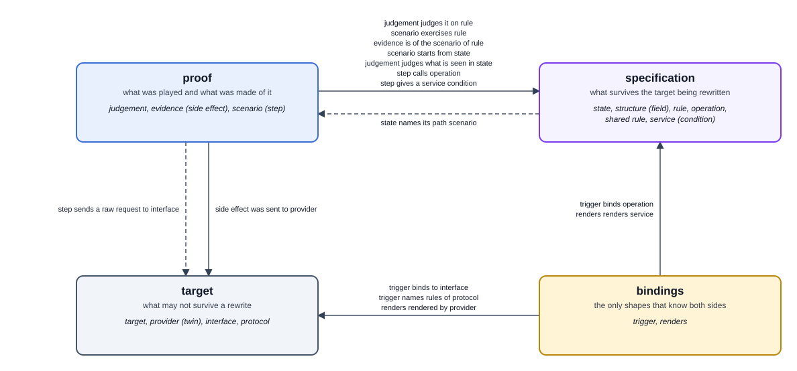
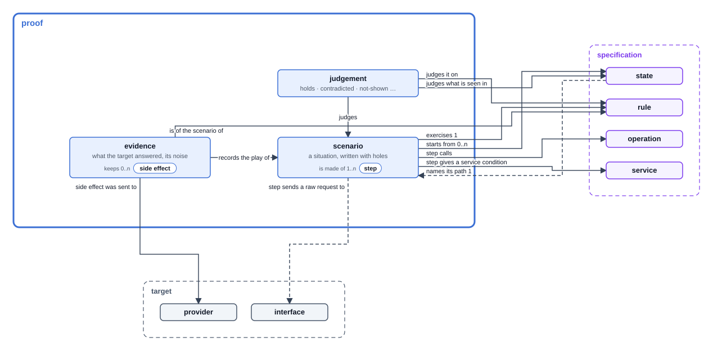
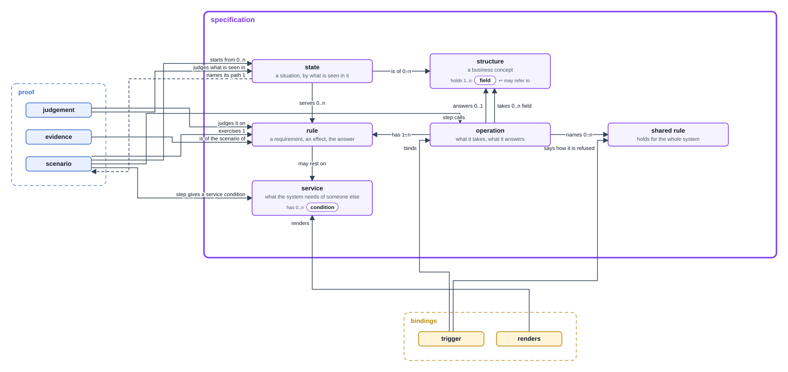
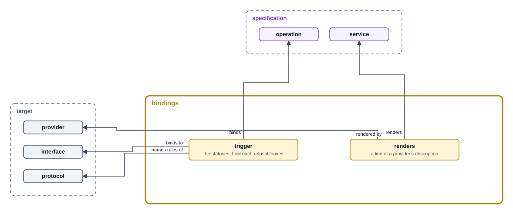
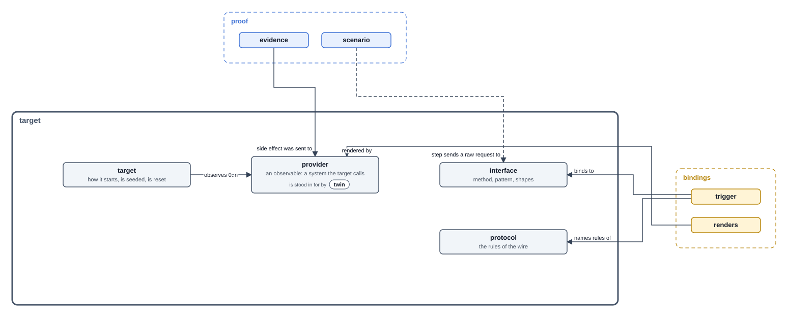

# The metamodel

The concepts exspec writes down, the group each belongs to, and what names what. It is
written by hand after the schemas under `src/shapes/` — the shapes of the files of an
extraction — and shows the reading made by the roles (`exspec/operations/`,
`common.yaml`, `protocol.yaml`): a schema that changes a concept or a link changes
`metamodel.yaml` in the same commit. The reasons are in
[`adr/`](adr/README.md); how the files get written, in
[`extraction-flow.md`](extraction-flow.md).

## The source, and what changed

[`metamodel.yaml`](metamodel.yaml) is the source: a concept a line, a link a line. The
drawings under `metamodel/` are generated from it and committed; a test fails when they
are not those of the file.

```
bun scripts/metamodel.ts                            # draw docs/metamodel/*.svg again
git log -p docs/metamodel.yaml                      # what changed, commit by commit
bun scripts/metamodel.ts --since main --out <dir>   # the drawings, what changed since main coloured
```

With `--since`, a concept is the same concept by its name and a link by its two ends:
what is new is green, what changed orange — what it was is in its tooltip —, what is gone
red and struck; each change is also printed, a line each. A concept moved on its grid
(`at`) is not a change.

## The four responsibilities

Each concept belongs to one group, by what it answers for. An arrow goes from the group
that holds a name to the group it names; beside it, each link it stands for. A dashed
arrow is a link that leaves the direction of the references — see below.



The four drawings that follow zoom into one group each, as the levels of a C4 model do.
Every group that appears is a frame, named, and sits where it sits above: the one the
drawing is about has a thick border and holds all its concepts with their links; another
has a dashed border and holds only its concepts a link reaches. An arrow goes from the
concept that holds the name to the one it names; a concept keeps its group's colour in
every drawing.

A concept that is only a part of another — a field of a structure, a condition of a
service, a step of a scenario, a side effect of an evidence, the twin of a provider — is
drawn inside it, with the links between the two; a link that names the part is drawn at the
whole and says the part's name (`takes 0..n field`, `step calls`). The boxes left are the
concepts that stand by themselves.

### Proof



Files under `operations/<interface>/`.

| Concept | What it is | What it holds | Where | An instance |
|---|---|---|---|---|
| scenario | a situation played to show one rule | the rule, the situation in words, whether it was reached, its steps | `scenarios/<slug>.yaml` | `{rule: r, situation: "…", reached: yes, steps: […]}` |
| step | one thing done in a scenario: a call of an operation, a raw request, a condition given to a service, or a state to start from | when it is done (arrange, before, call, after), as whom, a name a later step cites, and the one key that tells its kind | a line of the scenario's `steps` | `{when: call, as: a, name: n, call: {operation: f, with: {x: 1}}}` |
| evidence | what the target answered when the scenario was played, written by the tool | the rule, the run (target, version, time), an exchange a step, the places where two plays disagreed (noise) | `evidence/<slug>.yaml` | `{rule: r, run: {…}, exchanges: […], noise: […]}` |
| side effect | what the target sent a provider while a step was played | the provider, the request sent, what it was answered | `side-effects` of an exchange of the evidence | `{observable: p, request: {method: post, path: /b}, response: {status: 200, body: {…}}}` |
| judgement | what the judge made of a scenario's evidence: on its rule, or on the sentence of the state it is the path of | the scenario, the rule or the state, whether the situation was reached, the verdict, a confidence, the evidence quoted, the hash of the text judged | `judgements.yaml` | `{scenario: a, rule: r, situation: "yes", verdict: holds, confidence: 0.9, evidence: "…", of: h}` |

### Specification



| Concept | What it is | What it holds | Where | An instance |
|---|---|---|---|---|
| operation | something the system does when asked | what it takes, the shared rules it is under, its rules, what it answers, what the reader is unsure of | `operations/<interface>/rules.yaml` | `{operation: f, takes: {a: {says: "…", field: [A, id]}}, common: [c], requires: […], effects: […], answers: {says: "…", structure: A}}` |
| rule | one thing an operation must do: a requirement and the refusal when it is not met, or an effect | its name, the fact in words, the refusal's name (a requirement), the service it rests on, the line of code it was read at | `requires` and `effects` of `rules.yaml` | `{rule: r, on: a, fact: "…", otherwise: gone, source: "src/a.ts:12"}` |
| shared rule | a requirement that holds for the whole system | its name, what it applies to, the fact, the refusal's name, its source | `common.yaml` | `{rule: c, applies-to: "…", fact: "…", otherwise: denied, source: "src/b.ts:3"}` |
| structure | a business concept the system keeps | its name, the field that identifies it, its fields | `structures.yaml` | `{structure: A, identity: id, fields: {…}}` |
| field | one thing a structure holds: a value, or a reference to a structure | a type and its limits, or the structure referred to | an entry of the structure's `fields` | `name: {type: string, max-length: 80}` · `owner: {structure: B}` |
| service | what the system needs of someone else, whoever renders it | its name, what it does in words, its conditions | `services/<service>.yaml` | `{service: s, says: "…", conditions: […]}` |
| condition | a situation a service can be put in for a scenario | its name, what it means, the parameters it takes | an entry of the service's `conditions` | `{condition: refuses, takes: {address: string}, says: "…"}` |
| state | a business situation a scenario starts from | its name, the structures it is about, what a reading shows once in it, the scenario that reaches it (its path), the rules it was gathered for | `states.yaml` | `{state: s, of: [A], seen: "reading the a shows …", path: f/a, serves: [g/r]}` |

### Bindings



Nothing points at a binding: it is read to play a call and to say how a refusal leaves,
never named by another file.

| Concept | What it is | What it holds | Where | An instance |
|---|---|---|---|---|
| trigger | how this target says an operation on its wire | the interface, the operation, where each input goes, the status of an accepted call, how each refusal leaves, the protocol rules that hold | `operations/<interface>/trigger.yaml` | `{trigger: f, interface: f, operation: f, sends: {a: [path, id]}, answers: {status: 200}, refuses: {gone: {status: 404}}, protocol: [p]}` |
| renders | which service a provider of this target renders | the provider's name, the service's name | the `renders` line of `providers/<name>/provider.yaml` | `{provider: p, renders: s, …}` |

### Target



The target names nothing outside itself: every arrow that crosses its frame comes in.

| Concept | What it is | What it holds | Where | An instance |
|---|---|---|---|---|
| target | the running software, and how exspec handles it | how it starts, is known alive, is seeded, reset and stopped, where its API is, the providers observed | `target.yaml` | `{target: t, start: […], alive: {method: get, path: /h, status: 200}, seed: […], reset: […], stop: […], api: {base-url: "…"}, observables: [{observable: p, kind: provider}]}` |
| interface | one entry of the target's wire | its name, the method, the path pattern, the shape of the request, the shape of each response by status | `interfaces.yaml` | `{interface: f, method: get, pattern: "/f/{a}", request: {path: {a: string}}, responses: {"200": {body: {id: string}}}}` |
| protocol | what the whole target says of its wire, apart from any operation | the settings it runs with, its rules about the wire, how a shared refusal leaves, its error bodies | `protocol.yaml` | `{rule: p, applies-to: "…", fact: "the body is a JSON object", otherwise: {refusal: malformed-body, status: 400, body: "…"}, source: "src/c.ts:8"}` |
| provider | a system the target calls, as the target's code expects it | its name, the form of its state, what the target expects of it, where the target calls it | `providers/<name>/provider.yaml`, `interfaces.yaml` | `{provider: p, renders: s, state: {shape: {kept: [string]}, says: "…"}, expects: [{expect: e, on: make, says: "…", source: "src/d.ts"}]}` |
| twin | the program that stands for a provider while scenarios are played | code: it answers the target as the provider would, and can be put in a service's conditions | `providers/<name>/twin.ts` | — |

## The direction of the references

| Group | Points at | Never at |
|---|---|---|
| proof | the specification; the provider a side effect was sent to | — |
| specification | itself only | the target, the bindings |
| bindings | the specification and the target | — |
| target | itself only | the specification |

Two places leave the table, both on purpose:

- **A state names its path.** A state is of the specification, its path is a scenario, of
  the proof: one entry of `states.yaml` holds both (ADR-0025). The state itself — its name,
  its structures, what is seen in it — says nothing of how it is reached.
- **A step may send a raw request.** A step that calls an operation names the
  specification; one written as a request names a method and a path of the target. Such a
  scenario does not survive a rewrite of the target's wire.

## What is not a concept

Every path in the tables above is under the `exspec/` directory of the target's checkout.

A hint (`hints.yaml`: for each rule, a situation and how to reach it) is a reader's note to
the builder, not a concept: nothing points at it once the scenarios are written.

What is not here is computed, never written: whether a rule is verified, whether a state
is reached, whether a judgement is stale, what an operation touches.
